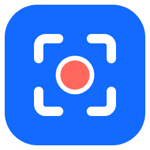
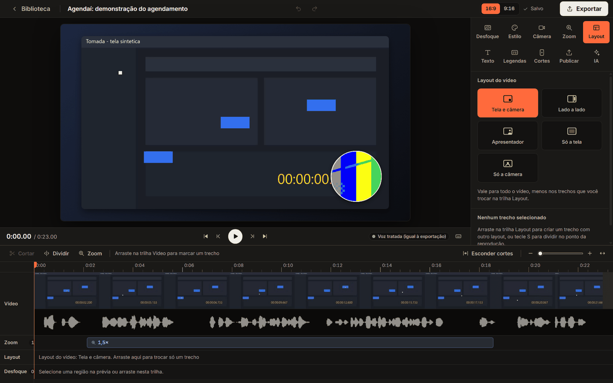
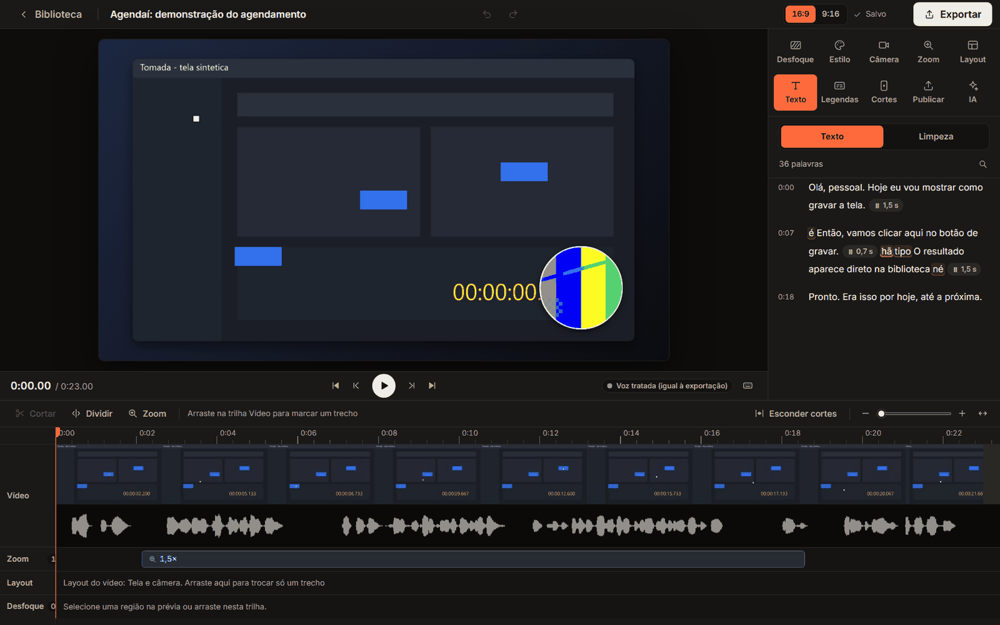
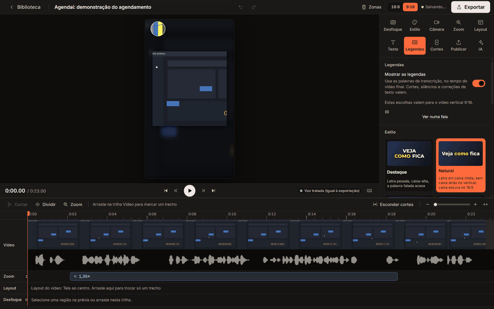
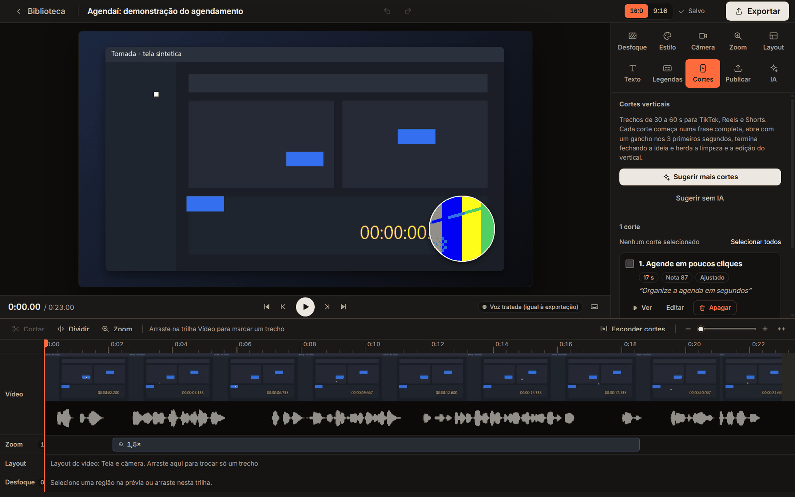
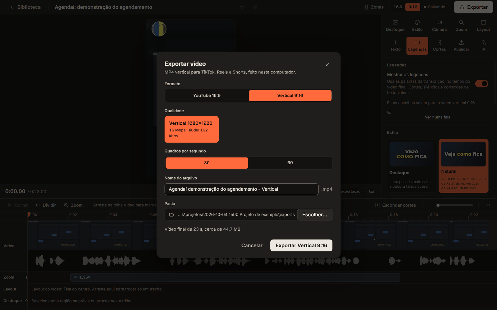

<p align="center">
  
</p>

<h1 align="center">Tomada</h1>

<p align="center">
  AI video editor for Windows. Record your screen once and get an edited YouTube video,
  vertical clips and a green screen cut, on your own PC.
</p>

<p align="center">
  English | <a href="README.pt-BR.md">Português</a>
</p>

<p align="center">
  <a href="LICENSE"></a>
  
</p>

*Tomada* is Portuguese for "take", as in a film take.

Tomada runs the Claude Code you already have installed and signed in on your own computer;
it never asks for or stores your credentials. It also works with an Anthropic API key.

<!-- demo -->



## What happens after you stop recording

Without any click, Tomada processes the recording, transcribes it on your GPU, cuts silences,
filler words and restarts, adds zooms on your clicks, picks the layouts, exports the YouTube
video, suggests the best vertical clips with captions and writes the title, description,
chapters and hashtags. Then you review, adjust and post. Tomada publishes nothing for you.

## Screens

| Edit by text | Vertical 9:16 with captions |
| --- | --- |
|  |  |

| Suggested vertical clips | Export |
| --- | --- |
|  |  |

The screens show a synthetic demo project: no real recording, face or personal data.

## Features

**Recording**
- Whole screen or a single window, with webcam and microphone.
- Cursor position and clicks are logged at 120 Hz, plus whether a key was pressed (never which).
- A browser window is recorded as the page only, without tabs and address bar.
- Teleprompter outside the recording, and a "mistake" hotkey that cuts the wrong sentence.

**Editing**
- Local transcription with word timestamps. Delete a word in the text and the video is cut.
- Automatic cleanup of silences, filler words and restarts, each one reversible, with a cut
  budget so the video keeps a natural pace.
- Cuts that do not feel like jump cuts: equal power audio crossfades, an alternating punch-in
  on your face, and no piece shorter than about a second between two cuts.
- Automatic zoom on clicks, layouts that follow the screen activity, captions in four styles.
- Camera as a bubble, side by side or alone, or cut out of your background with no green
  screen needed.
- Vertical green screen: the page fills the 9:16 frame and you stay in the corner opposite
  to what you are showing.
- Readable vertical video: the page is zoomed so body text lands around 30 px on a 1080 wide
  frame, and the view follows your cursor and clicks.
- Blur, pixelate or solid cover for sensitive regions. The original pixels are not in the export.
- Everything you change by hand is kept: the automatic pass never undoes it.

**Output**
- YouTube 16:9 at 1080p, 1440p or 4K, 30 or 60 fps.
- Vertical 1080x1920 clips of 30 to 60 seconds, with a hook and captions.
- Title, description with chapters, tags and hashtags for each platform, ready to copy.

**AI (needs Claude Code or an Anthropic API key)**
- Picks the best vertical clips, removes restarts, writes the publishing texts.
- "Adjust by asking": type "cut the start a little more" and the edit is applied.

Without an AI engine, Tomada still records, transcribes, cleans up and exports, and you can
edit by hand. The automatic AI editing is the core of the product and needs one of the two.

## Requirements

- Windows 10 or 11, 64-bit.
- **Claude Code**, installed and signed in with your own Claude subscription (Pro or Max).
  Alternatively, an **Anthropic API key**.
- [ffmpeg](https://ffmpeg.org/) on your `PATH`, or chosen in Settings.
- Python 3.11 (3.9 to 3.14 are accepted) to prepare the local transcription and cutout engines.
  Tomada builds its own virtual environment and downloads about 3 GB once.
- An NVIDIA GPU is recommended: transcription and cutout run on CUDA, and export uses
  hardware H.264 encoding when available. Without one, Tomada falls back to the CPU and is slower.
- Node.js 22 or newer, to run from source.

## Run from source

There is no installer yet.

```bash
git clone https://github.com/romulorgc/tomada.git
cd tomada
npm ci
npm run build
npm start
```

On the first run, the "Prepare Tomada" screen checks ffmpeg, GPU encoding, transcription, the
AI engine, camera and microphone. For development, use `npm run dev`. Tests: `npm run typecheck`,
`npm test` and `npm run test:e2e`. See [CONTRIBUTING.md](CONTRIBUTING.md).

## How it works

- **Capture.** A worker thread polls the cursor, the mouse buttons and the window rectangle
  through the Win32 API (`koffi`), at 120 Hz with a 1 ms timer resolution. Voice is recorded
  as raw PCM next to the video.
- **One renderer.** Preview and export draw every frame with the same pure functions on a
  Canvas 2D. Export runs in a hidden window, decodes with WebCodecs through `mediabunny` and
  encodes H.264 in hardware when available. The raw recording is never modified.
- **Local speech to text.** `faster-whisper` on the GPU in a private Python environment, with
  `whisper.cpp` as the second engine. Nothing is uploaded.
- **Local cutout.** RobustVideoMatting on ONNX Runtime, run in the background in 10 second
  chunks, so it resumes where it stopped if you close the app. A face detector drives the
  camera framing.
- **AI as text in, text out.** Only the transcript text is sent. With Claude Code, Tomada runs
  `claude -p` in an empty working directory, with tools disabled, no saved session and the
  request on stdin. With an API key, it calls the Messages API over HTTPS and stores the key
  encrypted with Electron `safeStorage`.
- **Non-destructive projects.** Each recording is a folder with the raw files and a
  `project.json`. The edit is a document, so undo and "try again" are cheap.

## Privacy

Recordings, transcripts and settings stay on your PC. The project has no server and no
telemetry. Network connections:

- first-run downloads of packages and models from PyPI, Hugging Face and GitHub;
- AI requests, only when you use the AI features: transcript text to Anthropic, through your
  Claude Code or your API key. Audio and video never leave your computer.

## Status and roadmap

Version 0.1. Windows only. The interface is in Brazilian Portuguese.

- [ ] Windows installer (`.exe`)
- [ ] English interface

## Contributing

Every change comes in as a pull request and is reviewed by the maintainer. Contributors sign a
CLA. Read [CONTRIBUTING.md](CONTRIBUTING.md). Report vulnerabilities as described in
[SECURITY.md](SECURITY.md).

## License

Tomada is released under the [GNU Affero General Public License v3.0](LICENSE). Third-party
components are listed in [THIRD_PARTY_NOTICES.md](THIRD_PARTY_NOTICES.md).

A separate commercial license is available for those who cannot use the AGPL-3.0 terms. To ask
about it, open an issue with the "Commercial license" template.

## Author

Created and maintained by Rômulo Carvalho.
[GitHub @romulorgc](https://github.com/romulorgc) | [X @romulocarvs](https://x.com/romulocarvs)
